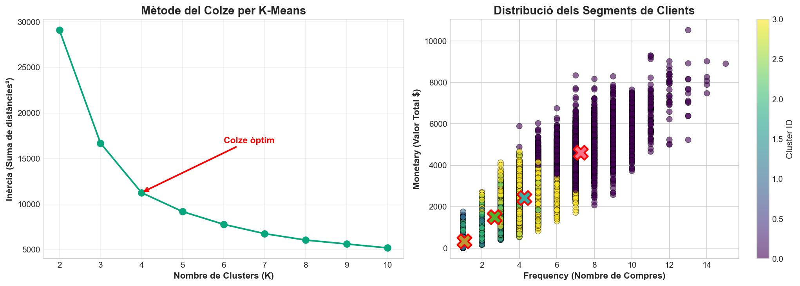
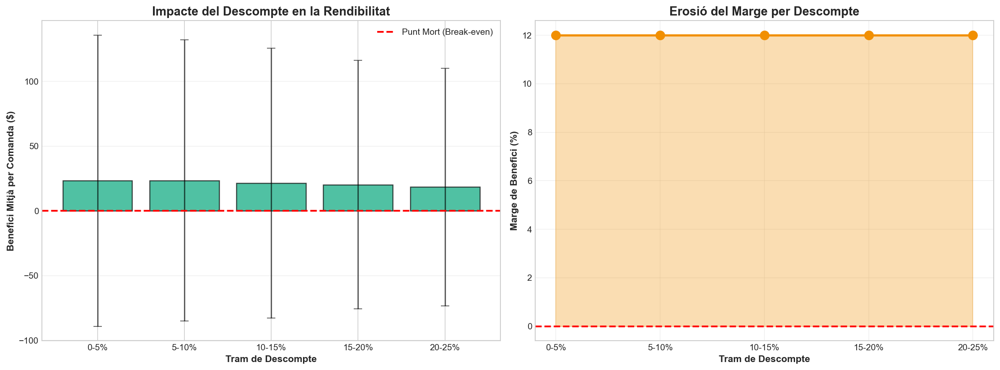

# Análisis exploratorio de una cadena de suministro (2015-2018)

Análisis exploratorio completo (EDA) de ≈180.000 pedidos de una empresa de comercio electrónico internacional, con foco en **puntualidad logística, rentabilidad, descuentos y segmentación de clientes**. Incluye visualizaciones geográficas interactivas y un informe en LaTeX.

*Práctica 1 de Sistemas de Información en las Organizaciones (SIO), Ingeniería Informática, ETSE - Universitat Rovira i Virgili (2025/26). Código y comentarios en catalán.*

**Autores:** Nawfal Aissaoui y Salma Jadiani

## Qué se hace

- **Limpieza** documentada de columnas redundantes y de datos personales (`src/02_neteja.py`).
- **Cribado visual sistemático** de todas las variables (`src/03_screening_visual.py`).
- **Análisis univariante, bivariante y multivariante** con tests estadísticos (chi-cuadrado, Pearson, Spearman, Kolmogorov-Smirnov).
- **Estudios específicos:**
  - Análisis de Pareto de productos y su evolución anual.
  - Segmentación de clientes con **RFM + K-Means**.
  - Análisis de **descuentos y punto de equilibrio**.
  - **Simulación de escenarios** (¿qué pasaría si se limitaran los descuentos?).
- **Mapas interactivos** (Folium): riesgo de retraso por país, flujos logísticos, mapa de calor de demanda, categorías por región.

## Resultados destacados (según el informe)

- El **54,8 %** de los pedidos llega tarde, y el patrón es prácticamente idéntico en todas las regiones: apunta a un problema de cómo se calculan los plazos, no a la infraestructura del destino.
- El envío *First Class* falla en el **95,3 %** de los casos, mientras que *Standard Class* es el más fiable.
- Pareto muy concentrado: 7 productos (≈6 % del catálogo) generan el 80 % de la facturación, y en 2018 la concentración empeora.
- El margen unitario se mantiene positivo incluso con descuentos altos; la simulación estima que limitar los descuentos por encima del 12 % reduciría el beneficio total en torno a un **35 %** por pérdida de volumen.
- El clustering RFM identifica un grupo de clientes de alto gasto que lleva meses sin comprar: prioridad para campañas de reactivación.

Detalle, gráficos y limitaciones del estudio (p. ej. falta de costes reales de transporte): [`report/Informe_Practica1_EDA.pdf`](report/Informe_Practica1_EDA.pdf).




## Stack

Python · pandas · NumPy · SciPy · scikit-learn · matplotlib · seaborn · Folium · GeoPandas · Jupyter · LaTeX

## Estructura

```
├── src/                      Scripts numerados en orden de ejecución
├── Analisi_Exploratoria.ipynb        Notebook del análisis completo
├── Visualitzacions_Geografiques.ipynb  Notebook de los mapas
├── data/                     Diccionario de datos (los datos no se incluyen, ver data/README.md)
├── figures/                  Gráficos generados (final/, maps/, exploratory/)
└── report/                   Informe en LaTeX y PDF
```

## Cómo reproducirlo

```bash
python -m venv .venv
# Windows: .venv\Scripts\activate    |    Linux/Mac: source .venv/bin/activate
pip install -r requirements.txt
```

1. Coloca los datos en `data/` (ver [data/README.md](data/README.md)).
2. **Ejecuta siempre desde la raíz del repositorio** (las rutas son relativas):

```bash
python src/02_neteja.py
python src/04_analisi_exploratoria.py
python src/05_visualitzacions_geografiques.py
```

Los notebooks (`.ipynb`) también deben abrirse desde la raíz. Para compilar el informe: `cd report && pdflatex main.tex` (dos veces).
